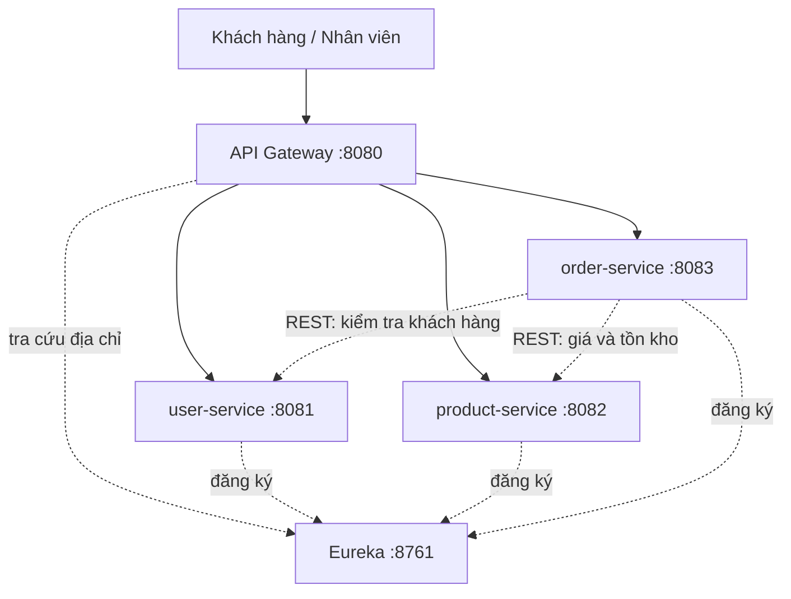

# BookMart — MSS301 E-commerce

Hệ thống bán sách trực tuyến theo kiến trúc microservices, dùng Spring Boot và Spring Cloud. Giai đoạn 2 chạy local qua Eureka và API Gateway. Docker để giai đoạn 3.

## Mục tiêu project

Xây một hệ thống gồm Service Discovery, API Gateway và ba microservices, chạy độc lập rồi giao tiếp qua REST. Bài toán cụ thể là **BookMart**: khách hàng có tài khoản, cửa hàng quản lý sách, khách đặt và theo dõi đơn hàng.

Giai đoạn 2 đã có API REST cho ba service, Eureka, Gateway định tuyến, và `order-service` gọi hai service kia khi tạo hoặc hủy đơn. Docker để giai đoạn 3.

## Thành viên nhóm

| Thành viên | MSSV | Vai trò |
| --- | --- | --- |
| Hồ Huy Thành | HE187135 | Nhóm trưởng, phụ trách nền tảng: Discovery Server, API Gateway, `user-service`, sơ đồ kiến trúc và README. |
| Bạch Văn Đức | HE181874 | Phụ trách nghiệp vụ bán hàng: phân tích bài toán, so sánh kiến trúc, `product-service`, `order-service`. |

Chi tiết phân công nằm ở [docs/phan-cong-nhom.docx](docs/phan-cong-nhom.docx).

## Kiến trúc tổng quát

Client chỉ đi qua API Gateway. Gateway chuyển request tới đúng service. Eureka là Service Discovery: các service đăng ký địa chỉ tại đây để Gateway và các service tìm nhau. `order-service` gọi `user-service` và `product-service` bằng REST khi tạo đơn.

| Thành phần | Thư mục | Cổng |
| --- | --- | --- |
| Service Discovery (Eureka) | `/discovery-server` | 8761 |
| API Gateway | `/api-gateway` | 8080 |
| user-service | `/services/user-service` | 8081 |
| product-service | `/services/product-service` | 8082 |
| order-service | `/services/order-service` | 8083 |



Sơ đồ đầy đủ: [docs/architecture-diagram.html](docs/architecture-diagram.html), [docs/so-do-kien-truc.docx](docs/so-do-kien-truc.docx). Luồng request giai đoạn 2: [docs/luong-request.md](docs/luong-request.md).

## Tài liệu

- [Phân tích bài toán](docs/phan-tich-bai-toan.docx)
- [So sánh Monolithic và Microservices](docs/so-sanh-monolithic-va-microservices.docx)
- [Sơ đồ kiến trúc](docs/so-do-kien-truc.docx)
- [Phân công nhóm](docs/phan-cong-nhom.docx)
- [Luồng request giai đoạn 2](docs/luong-request.md)

## Cấu trúc thư mục

```text
/docs
/discovery-server
/api-gateway
/services
  /user-service
  /product-service
  /order-service
README.md
```

Mỗi thư mục là một project Spring Boot riêng, build bằng Maven, Java 21. Ba service có controller, service, repository và một database SQL Server riêng.

## Cơ sở dữ liệu

SQL Server Express trên máy này, instance `localhost\DUCBACH`, cổng 1433. Mỗi service một database, không dùng chung bảng.

| Service | Database |
| --- | --- |
| user-service | `bookmart_user` |
| product-service | `bookmart_product` |
| order-service | `bookmart_order` |

Đăng nhập trong SSMS: server `localhost\DUCBACH`, login `bookmart`, mật khẩu `BookMart@2026`. Hibernate tự tạo bảng khi service khởi động (`ddl-auto=update`). Cột chữ dùng `nvarchar` để giữ tiếng Việt. Cấu hình nằm trong `application.properties` của từng service.

## Hướng dẫn chạy local

Cần Java 21. Trong thư mục project có Maven Wrapper, không cần cài Maven riêng. Mở năm terminal, đứng tại `MSS301_Project_E-comerce`, chạy theo thứ tự Eureka trước:

```text
.\mvnw.cmd -f discovery-server\pom.xml spring-boot:run
.\mvnw.cmd -f services\user-service\pom.xml spring-boot:run
.\mvnw.cmd -f services\product-service\pom.xml spring-boot:run
.\mvnw.cmd -f services\order-service\pom.xml spring-boot:run
.\mvnw.cmd -f api-gateway\pom.xml spring-boot:run
```

Đợi vài giây cho các service hiện trên Eureka: http://localhost:8761

Client gọi qua Gateway cổng 8080. Ba service vẫn mở cổng riêng để chạy độc lập: 8081, 8082, 8083.

Dữ liệu mẫu sau khi khởi động:

| Dữ liệu | Giá trị |
| --- | --- |
| Khách hàng | id 1, email `an@bookmart.local` |
| Nhân viên | id 2, email `ha.staff@bookmart.local` |
| Sách | id 1, 2, 3 |

Tạo đơn qua Gateway:

```text
curl.exe -X POST http://localhost:8080/api/orders -H "Content-Type: application/json" -d "{\"userId\":1,\"items\":[{\"productId\":1,\"quantity\":1}]}"
```

Xem sách, xem đơn của khách, rồi xác nhận đơn:

```text
curl.exe http://localhost:8080/api/products
curl.exe "http://localhost:8080/api/orders?userId=1"
curl.exe -X PATCH http://localhost:8080/api/orders/1/status -H "Content-Type: application/json" -d "{\"status\":\"CONFIRMED\"}"
```

Khi tạo đơn, tồn kho giảm. Hủy đơn (`CANCELLED`) thì tồn kho được cộng lại. Chi tiết từng bước nằm ở [docs/luong-request.md](docs/luong-request.md).
