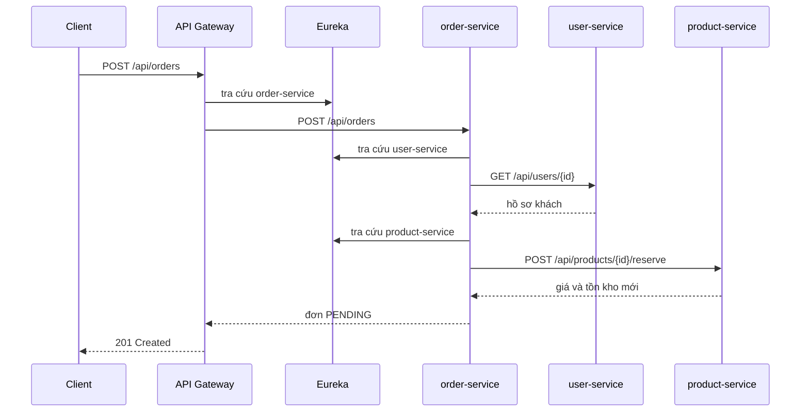

# Luồng request giai đoạn 2

Tài liệu này mô tả hệ thống BookMart khi chạy local, chưa dùng Docker. Client chỉ gọi API Gateway cổng 8080. Gateway tra địa chỉ service trên Eureka rồi chuyển tiếp request. `order-service` tự gọi hai service kia bằng REST khi tạo hoặc hủy đơn.

## Đăng ký với Eureka

Discovery Server chạy cổng 8761 và không tự đăng ký. Ba microservice và API Gateway đăng ký `spring.application.name` của mình. Gateway và `order-service` hỏi Eureka mỗi 5 giây để lấy địa chỉ mới.

| Service | Cổng | Tên đăng ký |
| --- | --- | --- |
| API Gateway | 8080 | `api-gateway` |
| user-service | 8081 | `user-service` |
| product-service | 8082 | `product-service` |
| order-service | 8083 | `order-service` |

Mỗi service có một database MySQL riêng: `bookmart_user`, `bookmart_product`, `bookmart_order`. Không có database dùng chung. Khi chạy Docker, cả ba database nằm trong container `mysql` trên network `bookmart-net`. Khi chạy local, MySQL lắng nghe `localhost:3306`.

## Route của API Gateway

| Đường dẫn | Service đích |
| --- | --- |
| `/api/users`, `/api/users/**` | `lb://user-service` |
| `/api/products`, `/api/products/**` | `lb://product-service` |
| `/api/orders`, `/api/orders/**` | `lb://order-service` |

`lb://` nghĩa là Gateway không gắn cổng cố định. Spring Cloud LoadBalancer lấy host và port từ Eureka.

## Luồng xem và sửa sách

1. Nhân viên hoặc khách gửi `GET http://localhost:8080/api/products`.
2. Gateway khớp route `product-service` và chuyển nguyên đường dẫn sang instance đang đăng ký.
3. `product-service` đọc bảng `books` và trả danh sách.
4. Có thể lọc bằng `title`, `author` hoặc `category`.
5. Thêm hoặc sửa sách đi cùng route, lần lượt là `POST /api/products` và `PUT /api/products/{id}`.

## Luồng tạo đơn

Khách gửi `POST http://localhost:8080/api/orders` với `userId` và danh sách `productId`, `quantity`.

1. Gateway chuyển request tới `order-service`.
2. `order-service` gọi `GET http://user-service/api/users/{userId}`. Địa chỉ thật do Eureka cấp. Nếu khách không tồn tại, đơn bị từ chối.
3. Với mỗi sách, `order-service` gọi `POST http://product-service/api/products/{id}/reserve`. `product-service` kiểm tra tồn kho, trừ số lượng và trả về giá hiện tại.
4. `order-service` lưu đơn trạng thái `PENDING`, kèm `productId`, số lượng và đơn giá tại thời điểm đặt. Đơn giá nằm trong `orderdb`, không phải bản sao cả cuốn sách.
5. Nếu một cuốn không đủ hàng sau khi đã giữ các cuốn trước, `order-service` gọi `POST /api/products/{id}/release` để hoàn kho rồi trả lỗi.

## Luồng đổi trạng thái

Nhân viên gửi `PATCH /api/orders/{id}/status`.

Thứ tự hợp lệ:

- `PENDING` sang `CONFIRMED` hoặc `CANCELLED`
- `CONFIRMED` sang `SHIPPING` hoặc `CANCELLED`
- `SHIPPING` sang `COMPLETED`
- `COMPLETED` và `CANCELLED` không đổi tiếp

Khi hủy, `order-service` gọi `POST /api/products/{id}/release` cho từng dòng để cộng lại tồn kho, rồi mới lưu trạng thái `CANCELLED`.

## API chính

`user-service`

- `POST /api/users` đăng ký
- `GET /api/users` danh sách
- `GET /api/users/{id}` hồ sơ, dùng khi tạo đơn
- `PUT /api/users/{id}` cập nhật hồ sơ

`product-service`

- `GET /api/products` danh sách, có lọc
- `GET /api/products/{id}` chi tiết
- `POST /api/products` thêm sách
- `PUT /api/products/{id}` sửa sách, giá, tồn kho
- `POST /api/products/{id}/reserve` giữ hàng
- `POST /api/products/{id}/release` hoàn hàng

`order-service`

- `POST /api/orders` tạo đơn
- `GET /api/orders` mọi đơn
- `GET /api/orders?userId=` đơn của một khách
- `GET /api/orders/{id}` chi tiết
- `PATCH /api/orders/{id}/status` đổi trạng thái

Dữ liệu mẫu khi service khởi động lần đầu: khách `an@bookmart.local` (id 1), nhân viên `ha.staff@bookmart.local` (id 2), và ba cuốn sách id 1 đến 3.
